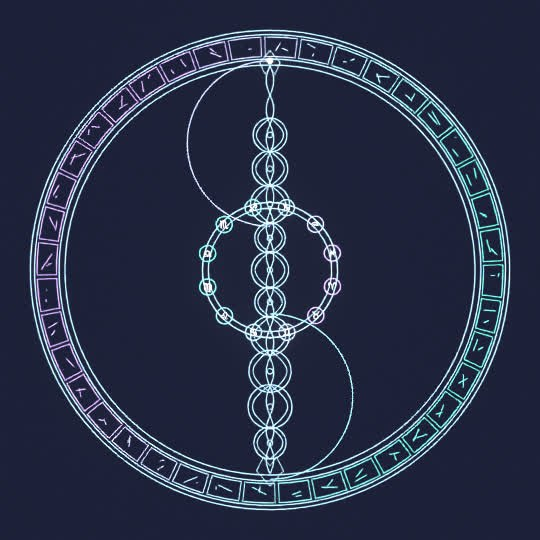
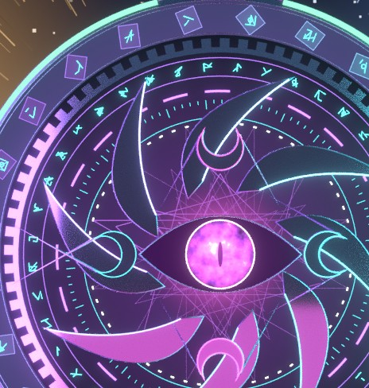
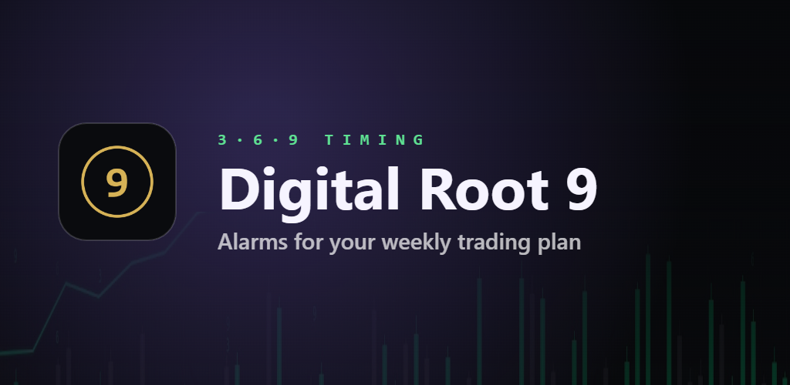
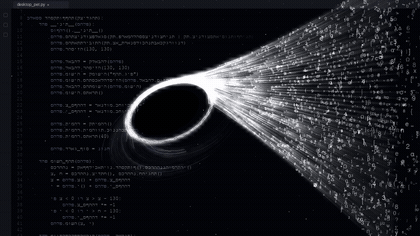
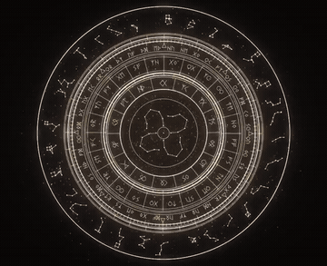

# Hi, I'm Anuradha Udayashan Senanayake 👋

Marketing professional and self-taught builder from Colombo, Sri Lanka. I design and build desktop apps, mobile apps, AI assistants and motion graphics.

> **Showcase only.** This page shows what I have built. No source code, methods or calculations are published here.

---

## 🔮 ORACLE — AI trading assistant for Windows

A desktop trading assistant with a team of AI agents working together on your own PC.

- Voice assistant you can talk to or type to
- Live watchlist for forex, crypto, metals and indices
- Smart alarms with sound, flash and voice
- Live candle chart with market alerts
- Trading journal with performance stats and an AI coach
- Native desktop app, licence activation (PRO / STANDARD)
- Read-only: it never places orders

  
  

---

## 🔢 Sepharial — desktop app

A Windows desktop app with its own installer that produces reports and feeds into ORACLE.

---

## 🤖 J.A.R.V.I.S — personal AI desktop assistant

My extended build of the open-source [Jarvis-AI](https://github.com/Ninja2007S/Jarvis-AI) by Ninja2007S. Features I added:

- Voice-switchable sub-agents for research and document creation
- Push-to-talk, voice ID, offline mode
- Works across 4 monitors
- Calls, messages, app control, YouTube tools and voice typing
- One-click Windows installer

---

## ⏰ Digital Root 9 Alarm — Android app

Turns a weekly plan into real phone alarms that ring even when the app is closed.

- Weekly plan loaded automatically
- Full-screen repeating alarms
- Silence an alarm from phone or computer
- Trade journal with export
- Works offline

---

## 🎨 Motion design

### Code Vortex

Original animation, rendered in 4K and vertical format for Shorts.

### Magic Circle

Original rotating sigil-circle animation at 60 fps.

---

## 📫 Contact

Open to opportunities and collaboration. Connect with me on LinkedIn.

---

© 2026 Anuradha Udayashan Senanayake. All rights reserved. No part of this page, its images or videos may be copied, reused or redistributed without written permission. Not financial advice.
